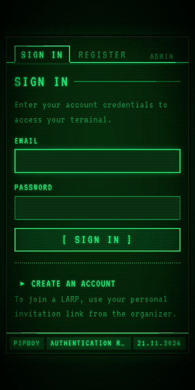
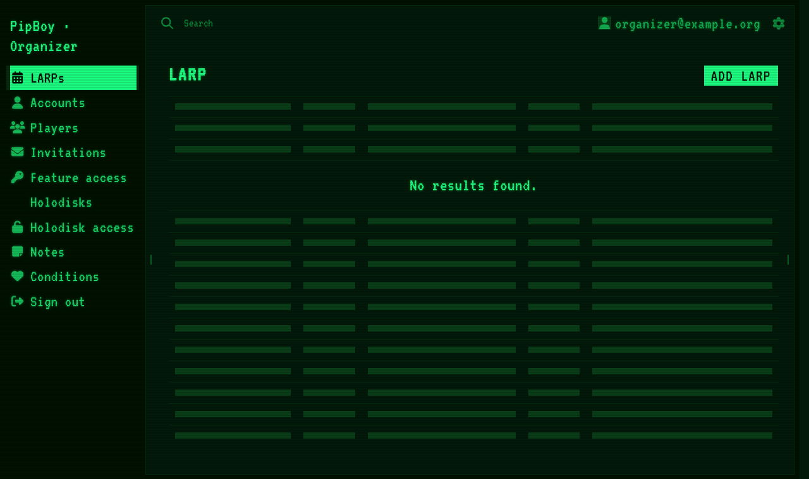

# 1. Get admin access

**Who:** someone with SSH access to the production server. **Time:** 2 minutes.

PipBoy ships without a default administrator. The first superadministrator is created on the server; after that, superadministrators can manage other accounts in the panel ([runbook 2](02-create-larp.md#3-make-someone-an-organizer)).

## Option A: promote an account you already registered

Use this if you have already signed up at `/register` or with Discord.

```bash
ssh <deploy user>@<server>
cd <PROJECT_DIR>                      # the deployment directory from the GitHub "prod" environment
php bin/console app:grant-admin you@example.org --env=prod
```

Expected output: `Superadministrator access granted. Sign in again to use the admin panel.`

## Option B: create a new administrator account

```bash
php bin/console app:create-user you@example.org --admin --env=prod
```

The command asks for a password (at least 12 characters) without showing it. It refuses an email that already has an account; use option A for that.

## Sign in to the panel

1. Open https://pipboy.larpilot.com and choose the **Admin** tab.

   

2. Sign in with your email and password. If you were already signed in before being promoted, sign out and in again: roles are loaded at sign-in.
3. You land on the organizer panel's LARP list.

   

## Troubleshooting

| Symptom | Fix |
| --- | --- |
| `No account uses this email` | Register the account first, or use option B. |
| Signed in, but `/admin` returns an access-denied error (HTTP 403) | The account is not an organizer, or you have not signed in again since being promoted. |
| `Use an interactive terminal` from `app:create-user` | Connect with an interactive SSH session; the password prompt needs a terminal. |
