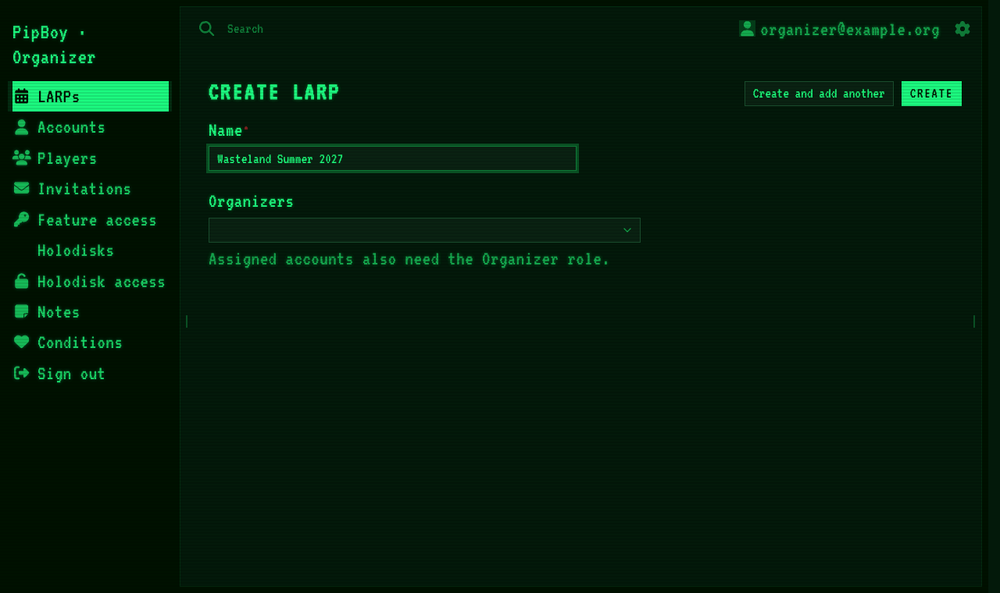
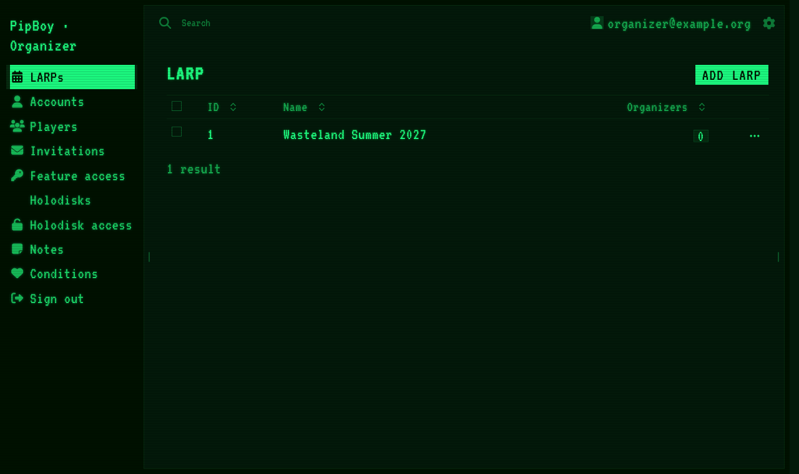

# 2. Create a LARP and assign organizers

**Who:** a superadministrator. Organizers cannot create or delete LARPs. **Time:** 3 minutes.

## 1. Create the LARP

1. In the panel, open **LARPs** and choose **Add LARP**.
2. Enter the **Name** players will see, for example `Wasteland Summer 2027`.
3. Optionally pick **Organizers** now (see step 3 below), then choose **Create**.

   

4. The LARP appears in the list.

   

## 2. What belongs to a LARP

Each LARP keeps its own players, invitations, holodisks and other game content. Nothing crosses between LARPs: the same account can play in two LARPs with two different characters and PipBoy numbers.

## 3. Make someone an organizer

Organizers need **both** the Organizer role and an assignment to the LARP.

1. The person registers an account at `/register` (or with Discord).
2. Open **Accounts**, edit their account and add **Organizer** under **Roles**. Save.
3. Open **LARPs**, edit the LARP and add them under **Organizers**. Save.
4. They sign out and in again. They now see only the LARPs they are assigned to.

A superadministrator sees every LARP and does not need to be assigned.

## Changing or removing a LARP

- **Rename:** use the row's **⋯** menu, then **Edit**.
- **Delete:** use the row's **⋯** menu, then **Delete** (superadministrators only). Delete only events that never started: deleting a LARP that already has players or content can fail or remove their game data.

Next: [invite players](03-invite-players.md).
