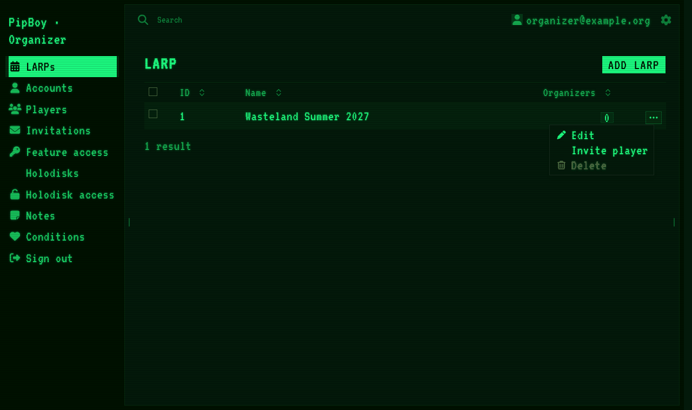
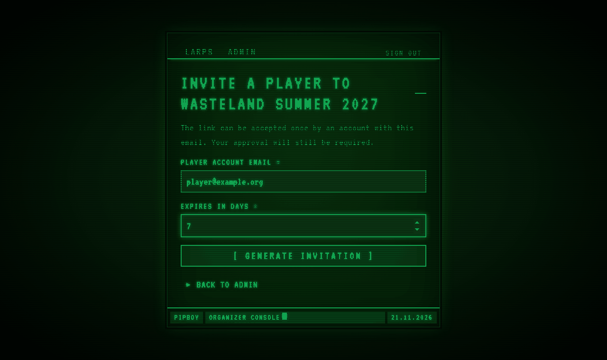
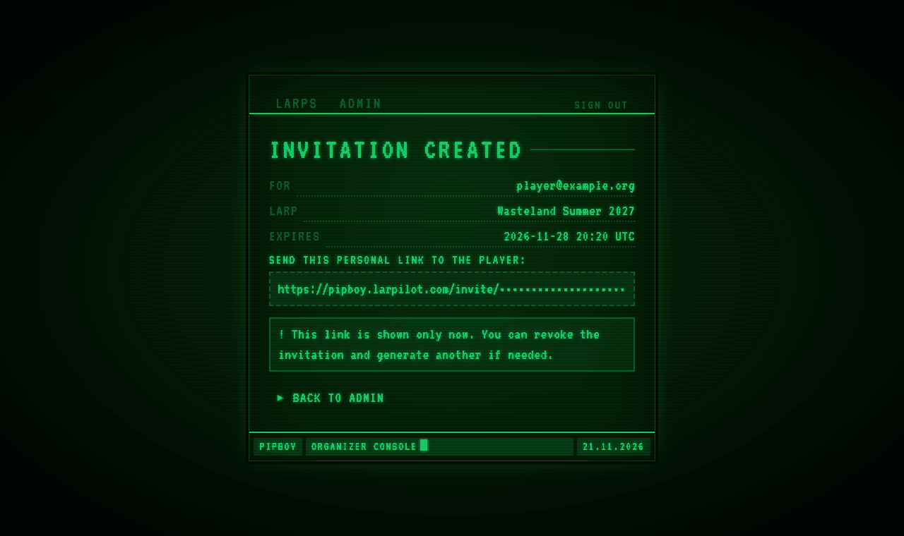
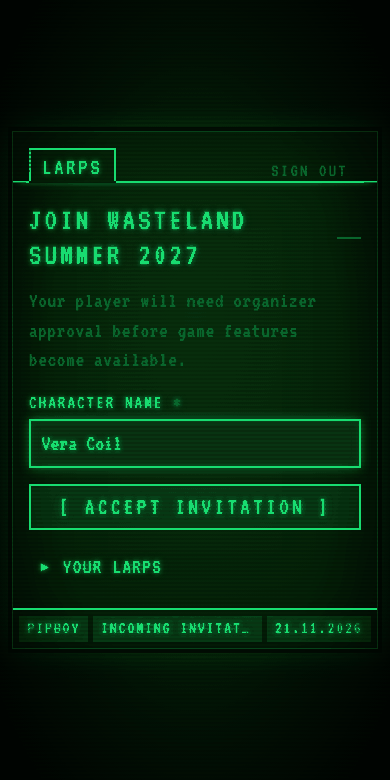
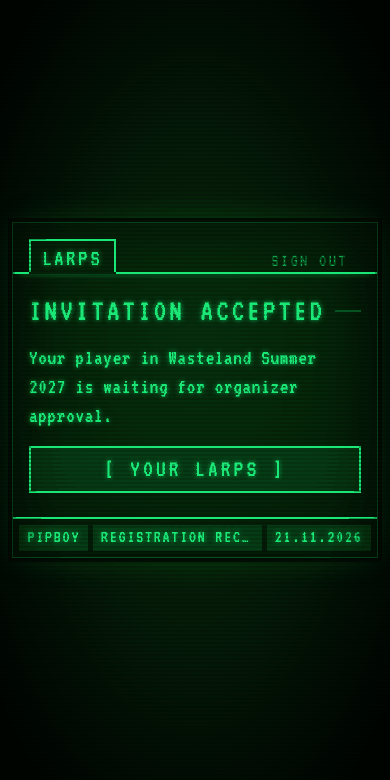
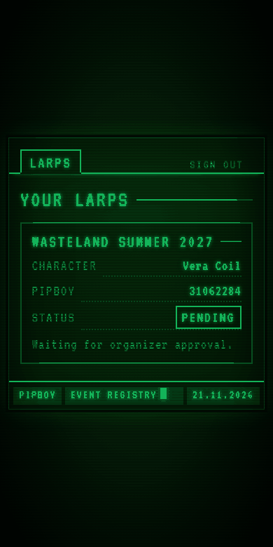
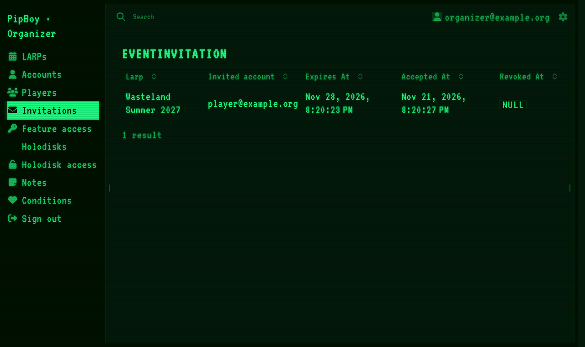

# 3. Invite players

**Who:** an organizer of the LARP, or a superadministrator. **Time:** 1 minute per player.

Every player gets a **personal** link bound to the email of their PipBoy account. The link only lets that account apply. It is not a password, and you still approve the player afterwards ([runbook 4](04-approve-players.md)).

## Before you start

Ask the player to **register first** at https://pipboy.larpilot.com/register and tell you the email they used. The invitation must use exactly that email.

## 1. Generate the link

1. Open **LARPs**, open the row's **⋯** menu and choose **Invite player**.

   

2. Enter the player's **account email** and how many days the link stays valid (1–30). Choose **Generate invitation**.

   

3. Copy the link and send it to the player through a channel you trust (direct message, personal email).

   

> The link is shown **only once** and only a fingerprint of it is stored. If you lose it, revoke the invitation and generate a new one.

## 2. What the player does

1. Signs in to their PipBoy account, then opens the link.
2. Enters the **character name** they will play and chooses **Accept invitation**.

   

3. Sees the confirmation, and the LARP appears on their PipBoy as **Pending**.

    

Opening the link does not use it up; only accepting does. A link works once, only for the invited account, and only until it expires.

## 3. Track or revoke invitations

Open **Invitations** to see every invitation for your LARPs: when it expires, when it was accepted, and whether it was revoked.

To cancel a link that was sent to the wrong person or leaked, use the row's **⋯** menu and choose **Revoke**. Only invitations that are not yet accepted or revoked offer it. Revoking stops the link from working. It does not remove a player who already joined; to do that, set the player to **Rejected** ([runbook 4](04-approve-players.md)).

## Troubleshooting

| The player sees | Cause and fix |
| --- | --- |
| **Another account required** | They are signed in with a different email. Sign out and sign in with the invited account, or revoke and re-invite their actual email. |
| **Invitation unavailable** | The link expired, was revoked or was already accepted. Generate a new one. |
| Nothing happens after signing in | Open the invitation link again after signing in. |

Next: [approve players and grant features](04-approve-players.md).
