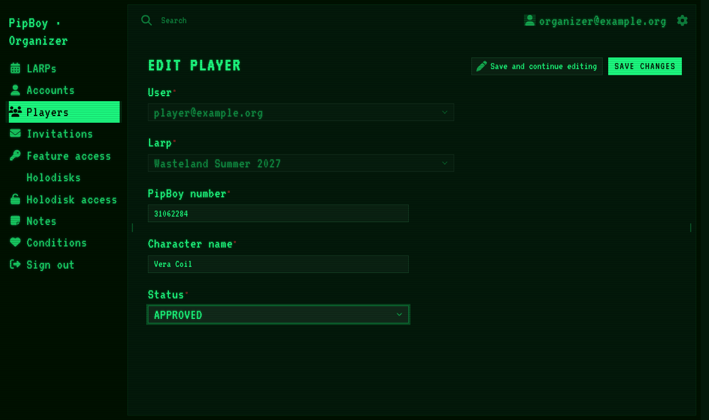
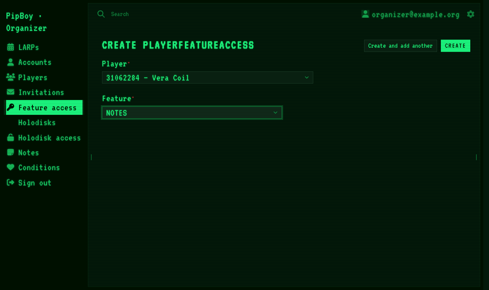
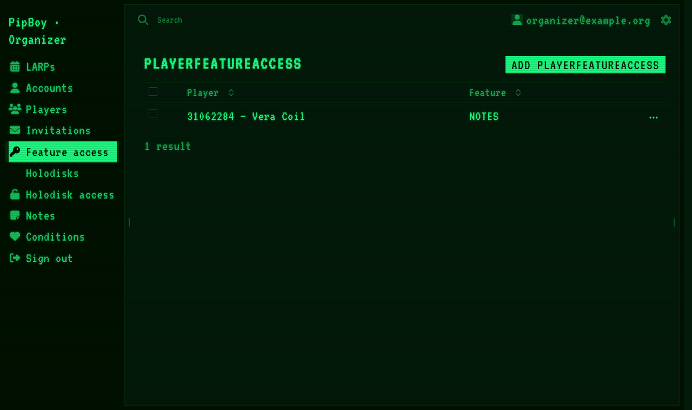
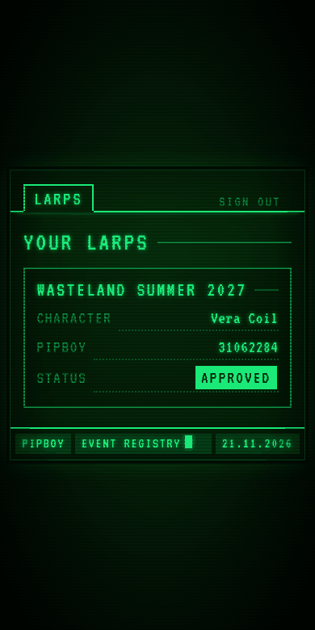

# 4. Approve players and grant features

**Who:** an organizer of the LARP, or a superadministrator. **Time:** 1 minute per player.

A player who accepted an invitation starts as **pending**. They can use game features only when **both** are true:

1. their status is **approved**, and
2. they have been granted that feature.

## 1. Approve the player

1. Open **Players**. Pending players show their account email, PipBoy number, character name and status.

   

2. Open the row's **⋯** menu and choose **Edit**.
3. Set **Status** to **APPROVED** and choose **Save changes**.

   

While editing you can also:

- **PipBoy number:** every player gets a random 8-digit number when they join. Change it if you hand out printed numbers; it must be unique within the LARP.
- **Character name:** correct the name the player entered.
- **Rejected:** use this status to refuse or remove a player from the LARP. Their account itself stays.

Never share a player's account email or real name with other players: in the game, players are identified by PipBoy number and character name. Real first and last names are visible only to superadministrators, in **Accounts**.

## 2. Grant features

1. In **Players**, open the row's **⋯** menu and choose **Grant feature**, or open **Feature access** and choose **Add PlayerFeatureAccess**.
2. Pick the **Player** (shown as `PipBoy number - character name`) and the **Feature**, then choose **Create**. Repeat for each feature.

   The form only offers grants that do not exist yet: players who already have every feature are not listed, and once a player is chosen the form reloads to show only the features they still lack.

   

3. The grant appears in the list. Remove a grant with the row's **⋯** menu and **Delete**.

   

| Feature | Meaning |
| --- | --- |
| NOTES | Personal notes |
| CHAT | Direct messages by PipBoy number |
| MAP | The event map |
| HOLODISKS | Unlocking holodisks by scanning |
| CONDITIONS | Fictional conditions (injuries, effects) |

Most player screens for these features are still being built (see the [roadmap](../roadmap.md)). Granting a feature now prepares the player's access for when it ships.

## 3. What the player sees

After approval, the LARP shows **Approved** on the player's PipBoy.

