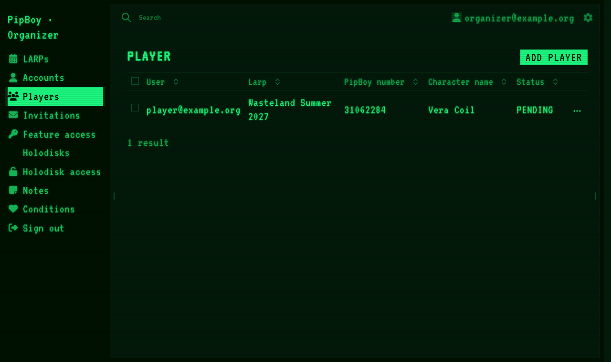
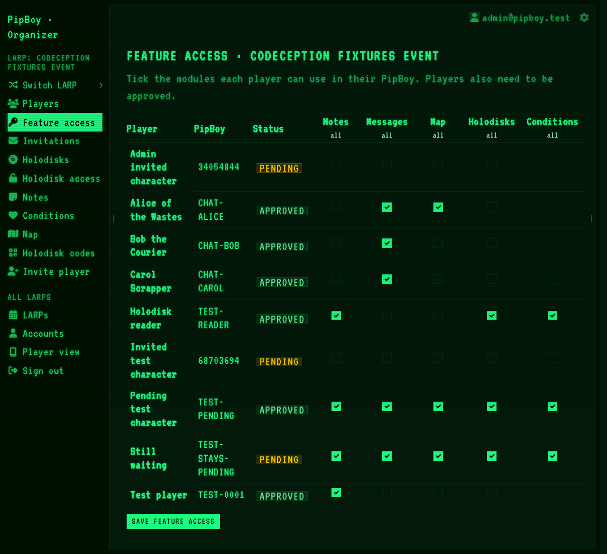

# 4. Approve players and grant features

**Who:** an organizer of the LARP, or a superadministrator. **Time:** 1 minute per player.

A player who accepted an invitation starts as **pending**. They can use game features only when **both** are true:

1. their status is **approved**, and
2. they have been granted that feature.

## 1. Approve the player

1. Open **Players**. Pending players show their account email, PipBoy number, character name and status.

   

2. Open the row's **⋯** menu and choose **Edit**.
3. Set **Status** to **APPROVED** and choose **Save changes**.

   

While editing you can also:

- **PipBoy number:** every player gets a random 8-digit number when they join. Change it if you hand out printed numbers; it must be unique within the LARP.
- **Character name:** correct the name the player entered.
- **Rejected:** use this status to refuse or remove a player from the LARP. Their account itself stays.

Never share a player's account email or real name with other players: in the game, players are identified by PipBoy number and character name. Real first and last names are visible only to superadministrators, in **Accounts**.

## 2. Grant features

1. Make sure the menu shows your LARP (**LARP: …** at the top; use **Switch LARP** if you manage several).
2. Open **Feature access**. Every player of the LARP is a row, every feature a column: tick or clear the boxes and choose **Save feature access**. The **all** link under a column header ticks (or clears) that feature for everyone.

   

3. For a single player you can also tick the **Features** boxes on the player's **Edit** form in **Players**.

| Feature | Meaning |
| --- | --- |
| Notes | DATA › Notes: organizer notes and the player's own private notes |
| Messages | COMMS › Messages: direct chat by PipBoy number |
| Map | MAP › Local map with the player's GPS position |
| Holodisks | DATA › Holodisks and DATA › Scan |
| Conditions | STAT › Conditions (injuries, effects) |

## 3. What the player sees

After approval, the LARP shows **Approved** on the player's PipBoy.

