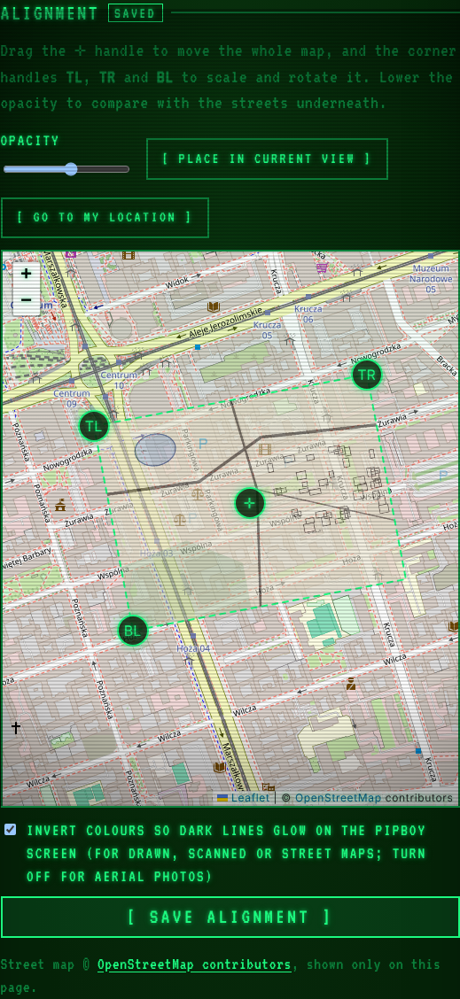
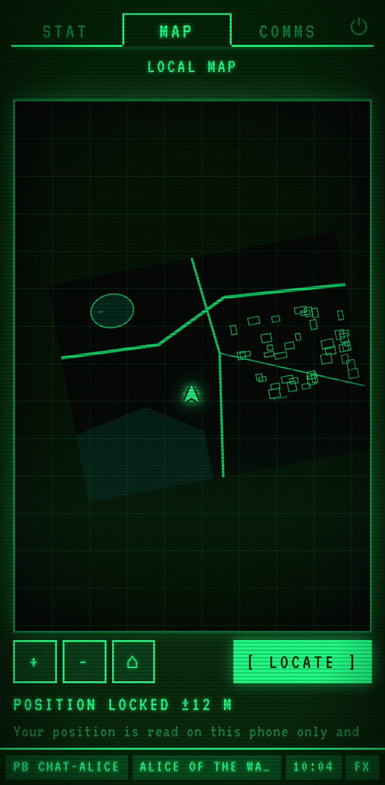

# 5. Upload and align the map

**Who:** an organizer of the LARP (or a superadministrator).

Players see your own map image, not a street map. It is aligned to real coordinates once, so their phones can show where they are on it.

## Prepare the image

- A drawn, scanned or exported map of the game area as JPEG, PNG or WebP, up to 15 MB.
- North-up is easiest, but you can rotate the image while aligning it.
- Light maps with dark lines look best: they are inverted so the lines glow green on the PipBoy screen. For an aerial photo, untick **Invert colours** when you save the alignment.

## Upload and align

1. In the admin panel open **LARPs** and choose **Map** in the row actions of your LARP.
2. Choose the image and press **Upload map**.
3. Zoom and pan the street map to the venue (**Go to my location** helps when you are there), then press **Place in current view**.
4. Lower the **Opacity** to see the streets through your map.
5. Drag **✛** to move the map, and **TR** or **BL** to turn and resize it until roads and buildings line up. **TL** moves the top-left corner while the top-right corner stays put.
6. Press **Save alignment**.

Uploading a corrected image later keeps the alignment, as long as it shows the same area with the same framing.

## What players see

Players need approval and the **Map** feature (runbook 4). They open **MAP › Local map** and press **Locate**: the arrow shows their position and the dashed circle its accuracy. Tap **Locate** again to re-centre, and once more to switch GPS off. Their position stays on their phone and is never sent to the organizers.

If players report the arrow in the wrong place everywhere, check the alignment against a few well-known spots (crossroads, building corners). Phones usually show ±5–20 m outdoors and are worse indoors or under trees.
