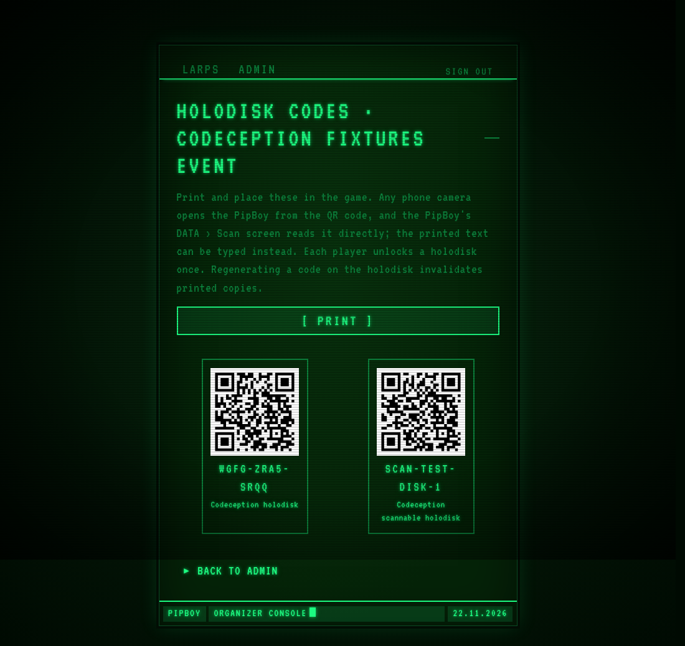
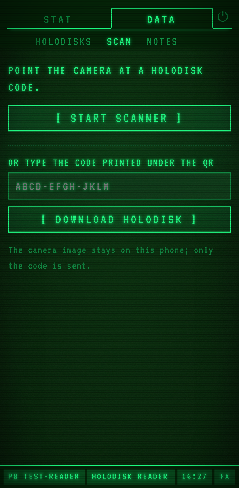
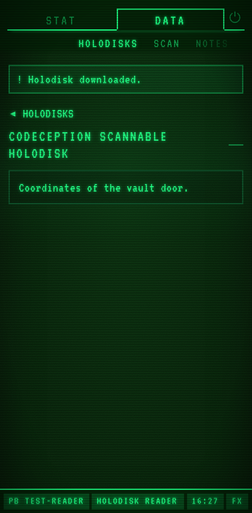

# 6. Print holodisk QR codes

**Who:** an organizer of the LARP (or a superadministrator).

Every holodisk has a secret code. Players who find its QR code in the game scan it and the holodisk appears in their PipBoy. Each player unlocks a holodisk once.

## Print the codes

1. Create the holodisks in **Admin › Holodisks** (title, text, optional image or MP3). Each new holodisk gets a code automatically.
2. In **LARPs**, choose **Holodisk codes** in the row actions of your LARP. For one holodisk, use **QR code** in the holodisk's row actions instead.
3. Press **Print**. The sheet prints the QR codes and the code text, without the holodisk titles.

Treat printed codes like keys: anyone who sees a code can type it. The sheet is not cached by the browser.

## Reuse existing printed labels

If you already have printed codes, open the holodisk's **Edit** page and enter the label's text in **Scan code** (letters and digits, 6–64 characters; spaces and hyphens are ignored). Each code can belong to one holodisk only.

To stop a printed code from working (lost or leaked label), tick **Generate a new code** and save, then print the new one.

## How players scan

Players need approval and the **Holodisks** feature (runbook 4).

- **With the phone's camera app:** the QR code opens the PipBoy. After signing in, the player presses **Download holodisk**.
- **In the PipBoy:** **DATA › Scan › Start scanner**, then point the camera at the code. If the camera doesn't work, the player can type the code printed under the QR.

The holodisk then opens in **DATA › Holodisks**.

A code from another LARP, a mistyped code, or a player without the Holodisks feature all show "No readable holodisk data in that code."

## Revoke access

In **Admin › Holodisk access**, edit the player's grant and tick **Revoked**. Scanning the same code again does not restore it; untick **Revoked** to give it back.
