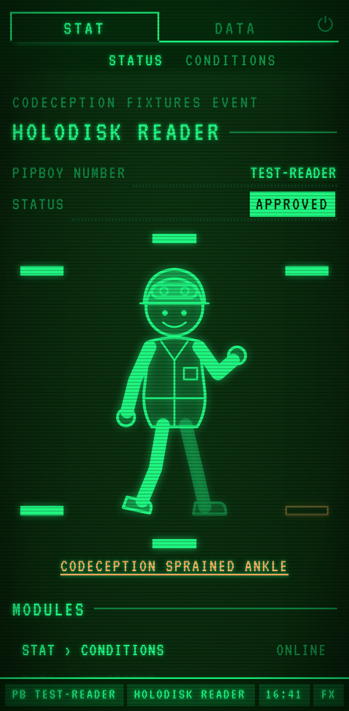
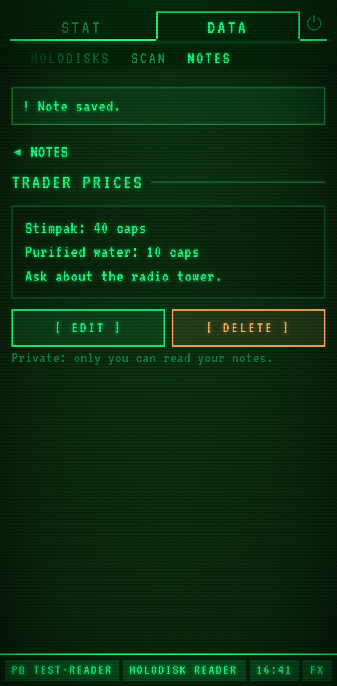

# 7. Conditions and notes

**Who:** an organizer of the LARP (or a superadministrator).

## Conditions on the STAT figure

Conditions are fictional states you give a player: an injury, poisoning, a curse. Players see them in **STAT › Conditions** when they have the **Conditions** feature.

1. In **Admin › Conditions**, create or edit a condition for the player: name, description, start and (optional) end.
2. Choose a **Body part** (head, torso, arms or legs) if the condition affects one.
3. While the condition is active, the matching bar next to the figure on the player's **STAT › Status** screen turns hollow and blinks, the body part flickers, and the condition's name appears under the figure.

Conditions without a body part appear only in the Conditions list. When the end time passes, the mark disappears by itself. The figure's left side is the character's right side, as if facing the player.

## Notes

- **Organizer notes:** in **Admin › Notes**, write a note for a player (clues, background, instructions). It appears in the player's **DATA › Notes** marked **Org**, and the player cannot change or delete it.
- **Player notes:** players with the **Notes** feature write their own notes with **New note**, and can edit or delete them. These notes are **private**: they never appear in the admin panel, not even for superadministrators.

