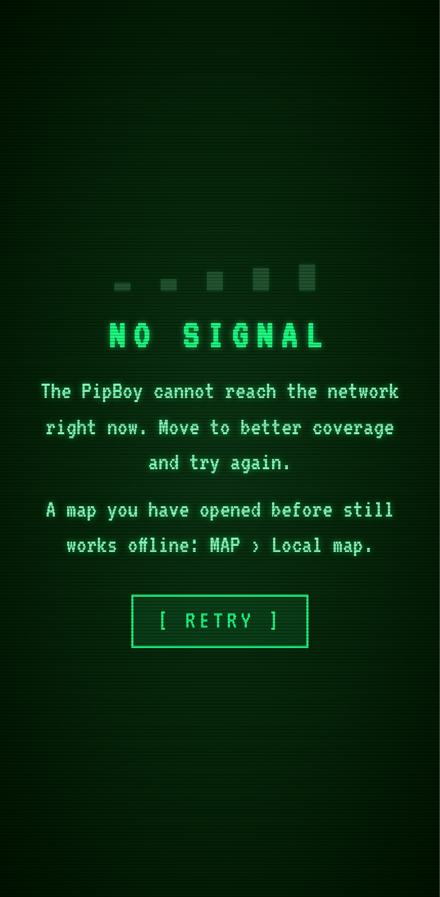

# 8. Install the PipBoy on a phone

**Who:** players. Share this page (or the steps) before the event.

The PipBoy installs to the home screen and opens full screen like an app. Nothing comes from an app store.

## Install

1. Open **https://pipboy.larpilot.com** in the phone's browser and sign in. Tick **Keep me signed in on this device for 30 days** so the app doesn't ask for the password every time.
2. On **Your LARPs**:
   - **Android (Chrome, Edge, Samsung Internet):** tap **Install PipBoy**. If the button doesn't appear, open the browser menu and choose **Install app** or **Add to Home screen**.
   - **iPhone / iPad (Safari):** tap **Share** ⬆, then **Add to Home Screen**. On iPhone this works from Safari only.
3. Open the PipBoy from its home-screen icon. On iPhone, sign in once more inside the app: home-screen apps keep their own sign-in.

## Without signal

- Pages that need the server (messages, holodisks, notes, status) show **No signal**. Tap **Retry** when you have coverage.
- **MAP › Local map** works offline once you've opened it with signal: the map and your GPS position keep working. Open it once before heading into areas with poor coverage.
- Signing out removes the stored map from the phone.

## Signing out

Use the ⏻ button and then **Sign out** on a shared or borrowed phone. Signing out also ends "Keep me signed in". Changing your password signs out every device.
