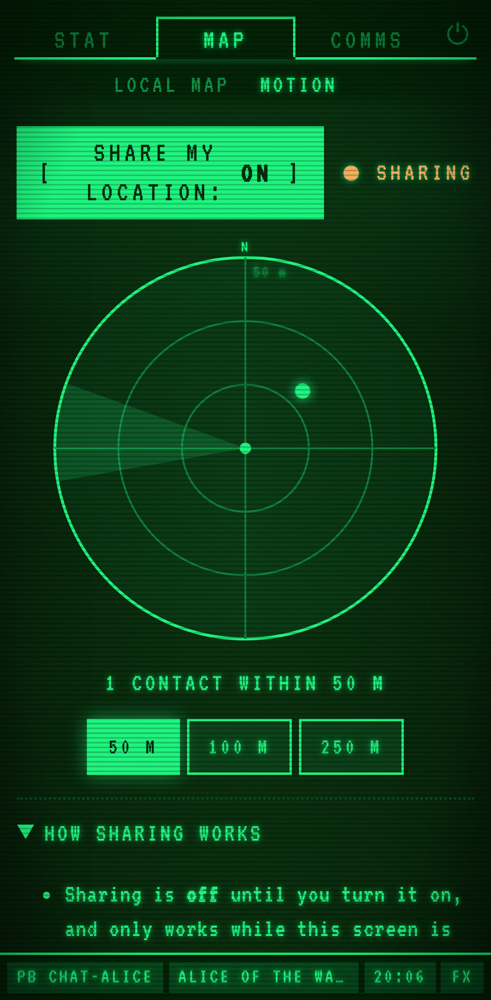

# 10. Motion detector (proof of concept)

**Who:** organizers enable it; players use it.

The motion detector is a radar in **MAP › Motion**. It shows other nearby PipBoys of the same LARP as anonymous blips, like a motion tracker.

## Enable it

In **Feature access**, tick **Motion detector** for the players who should have it (they also need to be approved).

## How players use it

1. Open **MAP › Motion** and tap **Share my location**. The phone asks for location permission the first time.
2. While sharing is **ON** (a blinking **SHARING** badge shows it), the radar shows other sharing PipBoys within 50, 100 or 250 m. North is up; the centre is you.
3. Tap again to switch it **OFF**. Leaving the screen also stops sharing.

## What is shared — tell your players

- Nothing is shared until the player switches it on, and only while the Motion screen is open.
- Other players see an **anonymous blip** at the player's position, rounded to about 5 m. No name, PipBoy number or coordinates are sent to anyone.
- A player sees others only while sharing themselves.
- Only the latest position is kept. It is deleted when sharing is switched off, hidden after a minute without updates, and removed after two hours.
- Organizers don't see positions in the admin panel.

## Limits of this proof of concept

- Phones stop sharing when the screen locks or the app is in the background.
- GPS is typically accurate to 5–20 m outdoors and worse indoors, so close contacts can jump around.
- Not yet tested with many players at once; each sharing phone contacts the server every few seconds.
